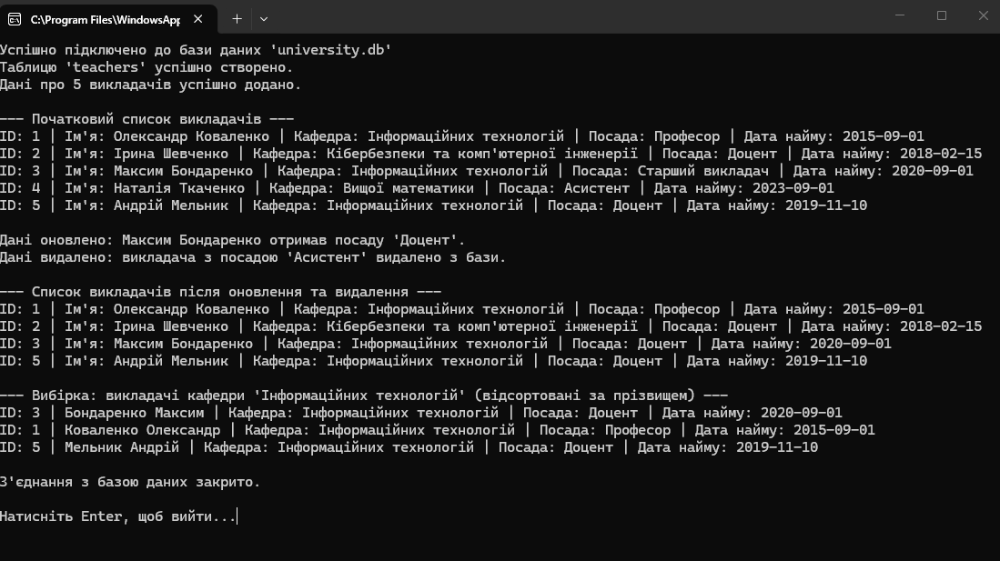
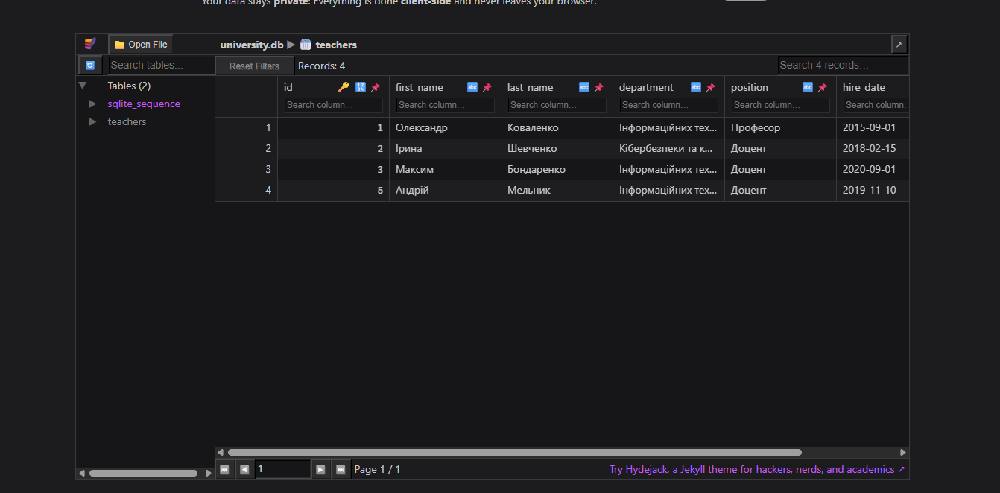

# Звіт до лабораторної роботи № 8

**Тема:** Підключення до бази даних та виконання основних операцій.

**Мета:** здобути практичні навички роботи з базами даних у мові програмування Python, навчитися виконувати базові операції (створення, вставка, оновлення, видалення, вибірка) та ознайомитися з принципами роботи з SQL.

---

## Хід роботи

### 1. Скріншоти виконання

**1. Результат виконання Python-скрипта в терміналі (створення таблиці, вставка 5 записів, оновлення, видалення та вибірка з сортуванням):**

**2. Вміст таблиці `teachers` у базі даних `university.db` після виконання всіх операцій:**

---

### 2. Контрольне запитання

**Мій варіант:** `8`

**Питання:** `Що таке збережені процедури і тригери в базах даних? Для чого вони використовуються?`

**Відповідь:**

1. **Збережені процедури (Stored Procedures)** — це підготовлені та скомпільовані набори SQL-інструкцій і керуючої логіки (умови, цикли, робота зі змінними та параметрами), які зберігаються безпосередньо на сервері бази даних і викликаються за ім'ям (наприклад, `CALL procedure_name(...)`).
   * **Для чого використовуються:**
     * **Підвищення продуктивності:** запит компілюється один раз і кешується сервером БД, а також зменшується мережевий трафік між клієнтським застосунком і сервером (передається лише виклик процедури, а не великий текст SQL-запитів).
     * **Повторне використання та інкапсуляція бізнес-логіки:** складні операції зберігаються в єдиному місці на рівні бази даних і можуть викликатися з різних програм.
     * **Безпека:** користувачам можна надати права лише на виконання процедури, не відкриваючи прямого доступу до самих таблиць.

2. **Тригери (Triggers)** — це спеціальні збережені процедури, які **виконуються автоматично** при настанні певної події модифікації даних у таблиці (`INSERT`, `UPDATE` або `DELETE`). Тригер може спрацьовувати до (`BEFORE`), після (`AFTER`) або замість (`INSTEAD OF`) виконання операції.
   * **Для чого використовуються:**
     * **Аудит та логування:** автоматичний запис історії змін у таблицю журналу (хто, коли та які саме дані змінив чи видалив).
     * **Підтримка складної цілісності даних:** автоматична перевірка бізнес-правил, які неможливо описати стандартними обмеженнями `CHECK` або `FOREIGN KEY`.
     * **Автоматична синхронізація та перерахунок даних:** наприклад, оновлення підсумкових полів у пов'язаних таблицях при додаванні чи видаленні рядків.

---

## Висновки

Під час виконання лабораторної роботи № 8 я здобув практичні навички роботи з реляційними базами даних у мові програмування Python за допомогою мови запитів SQL та модуля `sqlite3`. Було створено базу даних «Університет» (`university.db`) і таблицю «Викладачі» (`teachers`), що містить первинний ключ (`id INTEGER PRIMARY KEY`) та колонки різних типів даних (`VARCHAR`, `DATE`). Я навчився встановлювати з'єднання з базою даних, створювати курсор (`cursor`) та виконувати основні операції CRUD: масову вставку 5 записів (`INSERT INTO` за допомогою `executemany`), оновлення даних за умовою (`UPDATE ... WHERE`), видалення записів (`DELETE FROM ... WHERE`), а також вибірку даних із фільтрацією